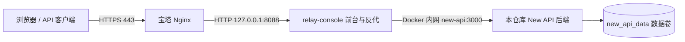

# ACE API：Linux 宝塔部署

**新站点推荐使用 [自动部署项目与 MySQL](DEPLOY-AUTO-MYSQL.md)**：数据库和应用一起启动，自动建库、设置账号与权限。下面保留传统 SQLite 和外接宝塔数据库的部署说明。已启用自动 MySQL 的用户，日常命令使用 `bash scripts/compose.sh`，更新使用 `bash scripts/deploy.sh --build`，不要混用下面只加载两份文件的旧启动命令。

当前项目采用 **React/Vite 客户前台 + 本仓库修改后的 New API 后端 + Docker Compose**。必须同时部署本仓库的两个服务；直接换用官方 New API 镜像会缺少本项目增加的利润、商品交付、鹈鹕测智等代码。

仓库：<https://github.com/kimihalle/ace-api-console>（当前公开，可直接通过 HTTPS 拉取）。本文默认使用单机 SQLite；要连接宝塔已有的 MySQL，先按 [MySQL 部署步骤](DEPLOY-MYSQL.md) 配置。首次构建需要访问 GitHub、Docker 镜像源、npm、Bun 和 Go 模块源。

**先决定是全新安装还是迁移已有数据。GitHub 只保存程序，不包含你本机的账号、余额、渠道密钥、支付配置、订单和调用记录。已有数据迁移见第 7 节。不要运行 `docker compose down -v` 或清理本项目的数据卷。**

## 1. 准备服务器

建议 Ubuntu 22.04/24.04 或 Debian 12，构建建议 4 核 / 8 GB、至少 20 GB 可用磁盘；小内存机器可能在后台前端构建时内存不足。

在宝塔安装 Nginx、Docker（Docker 管理器），确认包含 Compose v2 或更新版本。Git、OpenSSL 可通过服务器包管理器安装。下文使用 root SSH / 宝塔终端；普通用户需要对应的 Docker 和目录权限。

```bash
docker --version
docker compose version
git --version
openssl version
```

域名 A/AAAA 解析到服务器实际公网地址，只开放业务端口 80/443；SSH 和宝塔管理端口按你的管理需求放行。8088 只绑定 `127.0.0.1`，后端 3000 不发布主机端口。



## 2. 拉取仓库

当前仓库公开，无需账号、Token 或部署密钥，在服务器执行：

```bash
mkdir -p /opt
cd /opt
git clone https://github.com/kimihalle/ace-api-console.git ace-api
cd /opt/ace-api
```

拉取完成后直接继续第 3 节。部署后保持目录名不变，Compose 默认用目录名决定容器与卷的项目前缀；改目录或随意更换 `-p` 会创建另一套资源。

### 以后改回私有时配置 Deploy Key

仓库改回私有不会影响已运行的服务，但后续 `git pull` 需要授权。按下方配置只读 Deploy Key，再修改已有仓库的远程地址：

```bash
cd /opt/ace-api
git remote set-url origin git@github-ace-api:kimihalle/ace-api-console.git
```

先完成下面的 SSH 密钥及别名配置，再执行拉取。

在服务器生成部署密钥；如果同名文件已存在，使用原密钥，不要覆盖：

```bash
mkdir -p ~/.ssh
chmod 700 ~/.ssh
ssh-keygen -t ed25519 -C 'ace-api-baota' -f ~/.ssh/ace_api_deploy
cat ~/.ssh/ace_api_deploy.pub
```

复制公钥，到 [仓库 Deploy keys](https://github.com/kimihalle/ace-api-console/settings/keys) → **Add deploy key**。标题随意，Key 填公钥，保持 **Allow write access 不勾选**，即为只读。

在服务器添加 SSH 配置（只需执行一次）：

```bash
cat >> ~/.ssh/config <<'EOF'

Host github-ace-api
  HostName github.com
  User git
  IdentityFile ~/.ssh/ace_api_deploy
  IdentitiesOnly yes
EOF
chmod 600 ~/.ssh/config ~/.ssh/ace_api_deploy
ssh -T git@github-ace-api
```

首次连接按提示核对 GitHub 主机指纹；显示 `successfully authenticated` 即成功。GitHub 不提供 shell，该测试返回退出码 1 属正常现象。如果创建密钥时设置了口令，拉取时也需要输入口令或配置 ssh-agent。

已有仓库完成远程地址修改后，执行 `git pull --ff-only` 即可，不要再次 clone。只有尚未拉取且仓库已经私有时，才使用下面的首次拉取命令：

```bash
mkdir -p /opt
cd /opt
git clone git@github-ace-api:kimihalle/ace-api-console.git ace-api
cd /opt/ace-api
```

以下命令统一在 `/opt/ace-api` 执行。部署后保持目录名不变，Compose 默认用目录名决定容器与卷的项目前缀；改目录或随意更换 `-p` 会创建另一套资源。

## 3. 填写生产环境配置

以下初始化命令**只在全新安装时执行一次**；已有 `.env` 时直接编辑，不要覆盖原密钥。

```bash
cd /opt/ace-api
cp -n .env.example .env
chmod 600 .env
read -r -p '输入站点完整 HTTPS 地址（如 https://api.example.com，不带末尾 /）：' site_url
printf '\nSITE_URL=%s\nSESSION_SECRET=%s\nCRYPTO_SECRET=%s\n' \
  "$site_url" "$(openssl rand -hex 32)" "$(openssl rand -hex 32)" >> .env
```

`.env.example` 前面的空值会被文件最后同名的生产配置覆盖。也可以用宝塔文件编辑器手工整理成每项一行：

| 变量 | 配置方式 |
| --- | --- |
| `SITE_URL` | 你的完整 HTTPS 域名，仅协议和主机，不加 `/console` 等路径 |
| `SESSION_SECRET` | 固定随机密钥，首次生成后保留；更新时不重置 |
| `CRYPTO_SECRET` | 独立的固定随机密钥，迁移时保留原值 |
| `VITE_NEW_API_BASE_URL` | 留空，同源访问 |
| `VITE_NEW_API_CONSOLE_URL` | 留空，同站点后台 |
| `NEW_API_TARGET` | 本地 Vite 开发代理配置，Docker 生产反代不使用它 |
| `SQL_DSN` | 留空使用 SQLite；连接已有 MySQL 时填写连接串，见 [MySQL 文档](DEPLOY-MYSQL.md) |
| `LOG_SQL_DSN` | 留空表示日志跟随主数据库；非空时使用独立日志数据库 |

根目录 `.env` 中的变量必须被 Compose 显式引用才会进入容器。SMTP、渠道、计费和支付等业务配置主要在后台填写并保存在数据库中。

生产覆盖文件开启安全 Cookie，并把 `SITE_URL` 传给后端的 `SESSION_COOKIE_TRUSTED_URL`。三项必填生产变量缺失时 Compose 会报错，不会以不完整配置启动。

## 4. 构建并启动

```bash
cd /opt/ace-api
docker compose -f docker-compose.yml -f docker-compose.prod.yml config --quiet
docker compose -f docker-compose.yml -f docker-compose.prod.yml up -d --build
docker compose ps
docker compose logs --tail=80 new-api
curl -fsS http://127.0.0.1:8088/api/status
```

首次构建耗时取决于网络与服务器性能；后端健康检查通过后，前台服务才会启动。`config --quiet` 只校验而不打印密钥，不要把完整 `docker compose config` 输出发到公开地方。

**每次启动、重建或更新都要带两个 `-f`。** `ps`、`logs`、`stop` 这类只查询/控制现有容器的命令可使用基础文件。

HTTP 本机请求用于健康检查；生产模式的 Cookie 登录要在下一步配置好的 HTTPS 域名下测试。

## 5. 配置宝塔反向代理与 HTTPS

1. 宝塔「网站 → 添加站点」，绑定你的域名，不创建数据库，PHP 选择纯静态。
2. 「反向代理 → 添加反向代理」，代理目录 `/`，目标 URL `http://127.0.0.1:8088`，发送域名保持当前访问的域名。关闭代理缓存及静态资源缓存。
3. 编辑这条反代规则，确认 `location /` 的配置与下列一致。已有同名指令直接修改，不要重复新增 `location /` 或同名超时指令。若宝塔站点里存在默认静态文件正则缓存规则，移除它或让全站代理优先，避免 JS/CSS 被宝塔当成本地文件读取。

```nginx
location / {
    proxy_pass http://127.0.0.1:8088;
    proxy_http_version 1.1;
    proxy_set_header Host $http_host;
    proxy_set_header X-Real-IP $remote_addr;
    proxy_set_header X-Forwarded-For $remote_addr;
    proxy_set_header X-Forwarded-Proto $scheme;
    proxy_set_header Upgrade $http_upgrade;
    proxy_set_header Connection "upgrade";
    proxy_read_timeout 600s;
    proxy_send_timeout 600s;
    proxy_buffering off;
    proxy_cache off;
    client_max_body_size 32m;
}
```

4. 「SSL」申请证书并启用强制 HTTPS，保存配置并检查 Nginx 配置测试通过。域名存在 AAAA 记录时，对应 IPv6 也必须能访问验证端口。
5. 打开你的 HTTPS 域名：新装站点先访问 `/setup` 创建超级管理员，然后到 `/login` 登录。后台用户管理入口是 `/newapi-admin/users`，渠道入口是 `/newapi-admin/channels`。`/newapi-admin/` 根路径会跳回首页，不能把它当成初始化页面。

项目内层 Nginx 会保留宝塔传来的 `X-Forwarded-Proto`。这是“外层 HTTPS、内层 HTTP”部署所需的代理链；不要把内层 8088 改成公网监听。

如果只临时使用 HTTP/IP 调试，可以仅运行基础文件，但此时不应开放正式充值运营；配置好域名与 HTTPS 后，使用两份 Compose 文件重新创建容器。

## 6. 配置后台业务

登录管理员后，在后台配置并验收以下内容：

| 功能 | 需要填写或检查的内容 |
| --- | --- |
| 站点地址 | 后台 `ServerAddress`（服务器地址/站点地址）设为同一个 HTTPS 域名；`.env` 的 `SITE_URL` 不会自动改写数据库里的这个设置 |
| 渠道与模型 | 上游地址、密钥、模型映射、分组权限、销售倍率；测试真实调用和流式响应 |
| 利润 | 渠道进货倍率/成本配置，核对一笔调用收入、成本及毛利润；充值到账本身不是调用利润 |
| 邮箱 | SMTP 地址、端口、发件人、账号/授权码；按需开启邮箱验证、注册、找回密码并实际收信 |
| 充值与商品 | 支付网关、商品金额/额度、交付模式；仅开启一种交付方式时前台应隐藏选择项 |
| 支付回调 | 后台公网地址正确，网关能够访问本站 HTTPS `/api/` 回调；用小额订单验证到账或兑换码生成，再检查账单 |
| 第三方登录 | OAuth 应用的回调域名、Client ID/Secret；换域名后同步修改第三方平台 |
| 人机验证 | Turnstile 的 Site Key、Secret Key 和允许域名 |
| Passkey | 公网 HTTPS、RP ID/允许来源与实际域名匹配；从旧域名迁移需检查原有凭据的兼容配置 |

使用说明以当前后台表单提示为准。未配置的可选登录/验证功能保持关闭，不需要为了部署把所有开关都打开。

## 7. 把现在本机的数据迁移上去

**全新站点跳过本节。本节仅适用于 SQLite → SQLite 迁移；切换到 MySQL 不会读取旧 SQLite 文件，需要另做数据库迁移。要保留现在的账号、余额和配置，必须迁移数据，只拉 GitHub 不够。**

本机使用 Docker Desktop 时，先启动 Docker。下面在项目目录的 **PowerShell** 执行；会短暂停止本机后端，复制后自动恢复：

```powershell
Set-Location E:\zhongzhuan2
$backendId = docker compose -f docker-compose.yml ps -a -q new-api
if (-not $backendId) { throw '找不到本项目后端容器' }
$target = Join-Path (Get-Location) ('artifacts\linux-migration-' + (Get-Date -Format 'yyyyMMdd-HHmmss'))
New-Item -ItemType Directory -Path (Join-Path $target 'data') -Force | Out-Null
$wasRunning = docker inspect --format '{{.State.Running}}' $backendId
try {
    if ($wasRunning -eq 'true') {
        docker stop -t 60 $backendId
        if ($LASTEXITCODE -ne 0) { throw '停止后端失败' }
    }
    docker cp "${backendId}:/data/." (Join-Path $target 'data')
    if ($LASTEXITCODE -ne 0) { throw '复制数据失败' }
} finally {
    if ($wasRunning -eq 'true') { docker start $backendId }
}
Write-Output "迁移文件位置：$target"
```

用宝塔文件管理器/SFTP，把生成目录中的 **data 目录里的所有文件**（含数据库及附属文件）上传到服务器 `/opt/ace-api/migration-data/`，不要漏传隐藏文件。确保没有多嵌套一层 `data/data`。

如果原后端配置过固定 `SESSION_SECRET`、`CRYPTO_SECRET`，将原值安全地迁到服务器 `.env`；原配置若来自容器环境变量，要从原部署配置中取回，不能只复制前台 `.env`。保留原环境，先完成新服务器验证再切换 DNS。

服务器上先按第 3 节配置 `.env`、第 4 节构建镜像；**导入前不要在新站点完成 `/setup`**。上传文件后执行：

```bash
cd /opt/ace-api
docker compose -f docker-compose.yml -f docker-compose.prod.yml build
docker compose -f docker-compose.yml -f docker-compose.prod.yml create new-api
backend_id=$(docker compose -f docker-compose.yml ps -a -q new-api)
test -n "$backend_id" || exit 1
docker compose stop new-api
# 仅允许导入空数据目录，防止覆盖一个已经投入使用的新站点。
docker run --rm --volumes-from "$backend_id" \
  --mount type=bind,source=/opt/ace-api/migration-data,target=/import,readonly \
  alpine:3.22 sh -ec 'test -z "$(ls -A /data)" || { echo "目标数据卷非空，停止导入"; exit 1; }; cp -a /import/. /data/'
```

只有上述导入成功后，再执行第 4 节的 `up -d --build`。如果目标卷非空，不要直接覆盖；若只是误启动生成的测试库，先备份，再单独确认如何处理。迁移完成后用原管理员登录，核对余额、渠道、订单和调用记录，并把旧的站点地址/回调域名改为新域名。

迁移文件含渠道密钥和个人信息，确认服务器正常且已有备份后，从网站可访问目录及临时上传目录移走。

## 8. 备份、更新和回滚

### 备份 SQLite 数据与配置

本节说明传统 SQLite 路径。若已启用项目自带 MySQL，同一个 `bash scripts/backup.sh` 命令会自动改为导出 MySQL；详情见 [自动 MySQL 备份说明](DEPLOY-AUTO-MYSQL.md#4-密码备份与恢复)。

仓库提供备份脚本：自动找到当前容器真实挂载的数据，短暂停止后端写入，备份 `/data`、根目录 `.env` 和当前提交号，然后恢复原本运行的后端。

```bash
cd /opt/ace-api
bash scripts/backup.sh
```

文件位于 `backups/日期-随机后缀/`：`data.tgz`、`.env`（如果存在）和 `commit.txt`。备份目录已被 Git 和 Docker 构建忽略；复制一份到服务器之外。脚本仅适用于本文的单实例 SQLite 部署，外接数据库或其它写入节点需另做数据库备份。备份期间 API 会短暂不可用。

可以在宝塔计划任务中定时执行上面的命令；先手动成功一次。备份不是压缩包存在就算完成，应至少恢复到隔离环境验证一次。

### 拉取更新

以下命令中的 `backup.sh` 仅适用于 SQLite。MySQL 用户应先在宝塔备份实际业务库，再按 [MySQL 更新步骤](DEPLOY-MYSQL.md#6-mysql-的备份和更新) 操作。

```bash
cd /opt/ace-api
bash scripts/backup.sh
# 确认备份成功后再继续：
git pull --ff-only
docker compose -f docker-compose.yml -f docker-compose.prod.yml config --quiet
docker compose -f docker-compose.yml -f docker-compose.prod.yml up -d --build
docker compose ps
curl -fsS http://127.0.0.1:8088/api/status
```

不要对生产目录执行 `git reset --hard` 来处理未知冲突。更新后复查登录、真实 API 调用和支付状态；不要顺手清理数据卷。

### 代码回滚和数据恢复

优先根据备份目录的 `commit.txt` 选择回滚提交：

```bash
cd /opt/ace-api
git log --oneline -10
read -r -p '输入要恢复的已验证提交号：' release_commit
git switch --detach "$release_commit"
docker compose -f docker-compose.yml -f docker-compose.prod.yml up -d --build
```

代码回滚不会撤销数据库迁移；升级后若数据库结构不兼容，需要同时恢复升级前数据。恢复前先备份当前数据，并在维护窗口执行。选择一个已备份的 `data.tgz`，在全新隔离部署中先解压：

```bash
mkdir -p /opt/ace-api/migration-data
read -r -p '输入备份 data.tgz 的绝对路径：' archive_file
tar tzf "$archive_file" | head
tar xzf "$archive_file" -C /opt/ace-api/migration-data
```

按第 7 节流程导入**空数据卷**，同时恢复这份备份的 `.env` 密钥并匹配 `commit.txt` 版本。切换正式流量前验证数据。不要把备份直接解压覆盖正在运行的 SQLite 目录。

确认可以正常升级后，从分离提交状态返回主分支：`git switch main`，再按更新流程操作。

## 9. 排查与验收

```bash
cd /opt/ace-api
docker compose ps
docker compose logs --tail=100 new-api
docker compose logs --tail=100 relay-console
curl -fsS http://127.0.0.1:8088/api/status
ss -lntp | grep -E ':80|:443|:8088|:3000'
```

| 现象 | 先检查 |
| --- | --- |
| 构建下载超时 | 服务器是否能访问镜像仓库、npm/Bun/Go 模块源；网络错误不是 Compose 语法错误 |
| 构建被 Killed / 退出 137 | 内存不足，查看系统日志/内存，增加构建资源或交换空间 |
| `SESSION_COOKIE_SECURE=true requires…` | 两份 Compose 是否一起使用、`.env` 的 `SITE_URL` 是否为完整 HTTPS 域名 |
| 502 或后端 unhealthy | 后端启动日志、数据目录权限、端口、Docker 健康状态 |
| JS/CSS 404、页面空白 | 宝塔是否全站反代，是否残留静态缓存正则或旧代理缓存 |
| 登录刷新 403 或掉线 | HTTPS 域名与 `SITE_URL` 一致，密钥未重置，浏览器 Cookie 能写入；换域名后重新登录 |
| 支付后未到账/未发码 | 后台站点地址、网关签名与公网通知日志；不要手动反复补款后再放任旧回调到达 |
| 数据看似丢失 | 是否换了项目目录/Compose 项目名导致新卷；立即检查旧容器挂载，不要继续初始化或删卷 |

上线前至少验证：HTTPS 与续期、`/setup` 状态、登录/退出/刷新、按后台开关显示的注册与邮箱流程、一笔真实模型调用与扣费、小额支付自动交付、账单及利润数据、一次备份和隔离恢复。

本文配置已做 Compose 解析检查；正式服务器的域名、证书、邮件和支付回调仍需在部署后按以上步骤验证。
